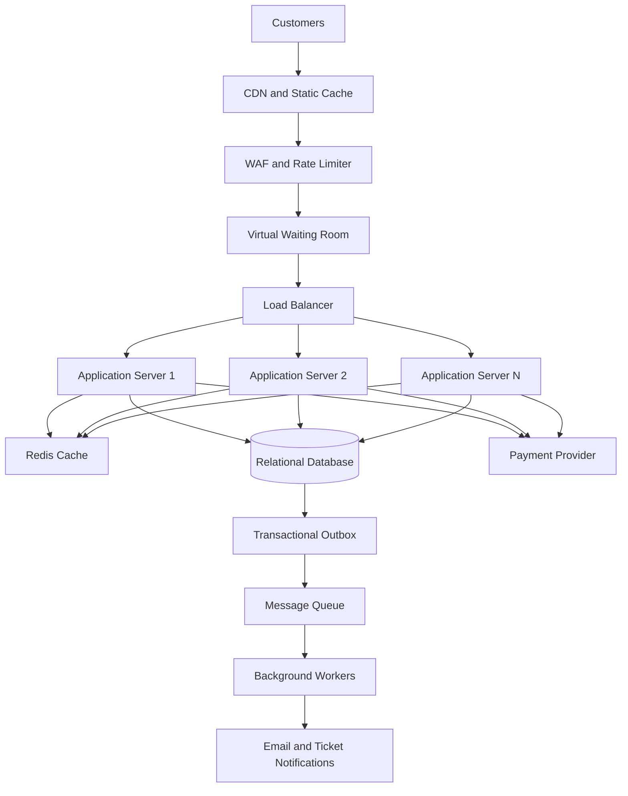

# TicketHub System Design

## 1. Requirements

TicketHub is a website where users can browse concerts and events, select seats, pay for tickets, and view their purchases. The system must support 2 million registered users and handle sudden traffic increases when popular concerts go on sale.

### 1.1 Functional requirements

- Users can register, log in, and manage their accounts.
- Users can browse, search, and view event details.
- Users can view available, held, and sold seats for an event.
- Users can temporarily hold available seats while completing checkout.
- Users can pay for their orders and receive booking confirmation.
- Users can view their purchased tickets and order history.
- Administrators can create events, configure seats, set prices, and monitor sales.
- The system releases expired seat holds so other customers can purchase those seats.

### 1.2 Non-functional requirements

- **Speed:** Event pages should load within 2 seconds under normal conditions. Seat availability and booking requests should receive responses within 1 second where possible, excluding payment-provider delays.
- **Correctness:** A seat must never be sold to two different customers. Payments and orders must remain consistent, even when requests fail or are repeated.
- **Fairness:** Customers should be processed through a fair queue during high-demand sales. The system should apply consistent rules and prevent automated users from unfairly monopolizing seats.
- **Scalability:** The system must handle sudden increases in visitors without becoming unavailable.
- **Availability:** Browsing and ticket purchasing should remain operational during traffic spikes, with graceful handling of temporary failures.
- **Security:** Passwords must be securely hashed, payment information protected, and APIs protected against unauthorized access and abuse.
- **Reliability:** Orders and payment results must not be lost if an application server fails.
- **Maintainability:** The system should use clearly separated components that can be updated and monitored independently.

## 2. Traffic Estimates

### 2.1 Normal daily traffic

Given:
- Registered users: 2,000,000.
- Daily visitors: 50,000.
- Pages viewed per visitor: 10.
- Tickets sold per day: 5,000.

**Daily page views**

50,000 visitors × 10 pages = **500,000 page views per day**.

Assuming traffic is spread evenly across 24 hours:

500,000 ÷ 86,400 = approximately **5.8 page views per second**.

**Average ticket sales**

5,000 tickets ÷ 86,400 = approximately **0.058 tickets per second**, or 208 tickets per hour on average.

Actual traffic will vary throughout the day, so the system must also handle short periods of higher demand.

### 2.2 Popular concert sale

Given:
- 200,000 people try to buy tickets.
- The sale lasts 10 minutes for this estimate.
- The concert has 20,000 seats.

**Average incoming purchase attempts**

200,000 ÷ 600 seconds = approximately **333 purchase attempts per second**.

**Seat demand**

200,000 people ÷ 20,000 seats = **10 people competing for each seat on average**.

**Ticket availability**

20,000 seats ÷ 200,000 interested buyers = **10% of buyers can obtain a seat**, assuming each person wants one seat and all seats are sold.

### 2.3 Comparison

| Metric | Normal day | Popular concert sale |
|---|---:|---:|
| Daily visitors / interested buyers | 50,000 | 200,000 in 10 minutes |
| Page views | 500,000 per day | Potentially millions of requests during the sale |
| Average page views per second | 5.8 | Depends on browsing behaviour |
| Purchase attempts | 5,000 tickets sold per day | About 333 attempts per second |
| Seats available for the event | Varies | 20,000 |
| Main challenge | Efficient everyday operation | Sudden traffic, fairness, and seat contention |

The big sale concentrates 200,000 interested buyers into only 10 minutes. The system therefore needs a waiting room, request rate limiting, caching, and scalable application servers. The database must remain the final authority on seat availability, even if many users try to select the same seat simultaneously.

## 3. API Design

TicketHub will provide a REST API over HTTPS. Requests and responses will use JSON. Authentication will use secure session cookies or access tokens.

| Method and endpoint | Purpose |
|---|---|
| `GET /api/events` | Browse and search upcoming events. |
| `GET /api/events/{eventId}` | View event details, venue, date, and ticket information. |
| `GET /api/events/{eventId}/seats` | Retrieve seat availability and prices. |
| `POST /api/seat-holds` | Temporarily reserve one or more available seats for checkout. |
| `DELETE /api/seat-holds/{holdId}` | Release a hold when the user cancels checkout. |
| `POST /api/orders` | Create an order from valid seat holds. |
| `POST /api/orders/{orderId}/payment` | Initiate payment for an order through a payment provider. |
| `GET /api/orders/{orderId}` | View order status and payment confirmation. |
| `GET /api/me/tickets` | View the authenticated user's purchased tickets. |

### API behaviour and safeguards

- Seat-hold requests must include the event, requested seat IDs, and an idempotency key.
- A successful hold expires after a short period, such as five minutes.
- If a seat is unavailable, the API returns `409 Conflict` rather than confirming a false reservation.
- Payment requests use idempotency keys to avoid duplicate charges when a user retries.
- The system confirms tickets only after the payment provider verifies successful payment.
- APIs enforce authentication, authorization, request validation, and rate limits.
- Seat availability shown in the browser is informational; availability must be rechecked when the user attempts to hold a seat.

## 4. Data Model

The database will use a relational database such as MySQL or PostgreSQL because ticket sales require strong consistency, transactions, and uniqueness constraints.

### 4.1 Tables

**Users**

| Column | Description |
|---|---|
| `user_id` | Primary key |
| `name` | Customer's name |
| `email` | Unique email address |
| `password_hash` | Securely hashed password |
| `created_at` | Account creation time |

**Events**

| Column | Description |
|---|---|
| `event_id` | Primary key |
| `title` | Event name |
| `venue` | Event location |
| `event_date` | Date and time of the event |
| `sale_start` | Ticket sale opening time |
| `status` | Draft, on sale, sold out, or cancelled |

**Seats**

| Column | Description |
|---|---|
| `seat_id` | Primary key |
| `event_id` | Foreign key referencing Events |
| `seat_number` | Seat identifier within the event |
| `price` | Ticket price |
| `status` | Available, held, or sold |
| `hold_id` | Active hold identifier, nullable |
| `hold_expires_at` | Expiration time of the hold, nullable |

A unique constraint on `(event_id, seat_number)` prevents duplicate seat definitions for an event.

**Orders**

| Column | Description |
|---|---|
| `order_id` | Primary key |
| `user_id` | Foreign key referencing Users |
| `created_at` | Order creation time |
| `total_amount` | Total price |
| `status` | Pending, paid, failed, or cancelled |
| `idempotency_key` | Unique request key to prevent duplicate orders |

**SeatHolds**

| Column | Description |
|---|---|
| `hold_id` | Primary key |
| `user_id` | Foreign key referencing Users |
| `event_id` | Foreign key referencing Events |
| `expires_at` | Hold expiration time |
| `status` | Active, converted, or released |

**OrderItems**

| Column | Description |
|---|---|
| `order_item_id` | Primary key |
| `order_id` | Foreign key referencing Orders |
| `seat_id` | Foreign key referencing Seats |
| `ticket_price` | Price captured at purchase time |

A unique constraint on `seat_id` in `OrderItems` prevents the same seat from being attached to two different orders.

**Payments**

| Column | Description |
|---|---|
| `payment_id` | Primary key |
| `order_id` | Foreign key referencing Orders |
| `provider_reference` | Payment provider's transaction reference |
| `amount` | Amount charged |
| `status` | Pending, successful, or failed |
| `created_at` | Payment record creation time |

Payment provider references should be unique to prevent the same provider transaction from being recorded more than once.

### 4.2 Relationships

- One user can create many orders.
- One event can contain many seats.
- One user can create many seat holds.
- One order can contain multiple order items.
- Each order item references one seat.
- Each order can have payment attempts recorded against it.
- A seat can have only one successful order item in the database.

These relationships use primary keys and foreign keys to maintain referential integrity.

## 5. Preventing Double-Booking

The most important correctness requirement is that two customers must never purchase the same seat. Checking availability only in the browser or application code is insufficient because multiple requests can arrive simultaneously.

### 5.1 Seat-holding process

1. The customer selects a seat and requests a hold.
2. The application begins a database transaction.
3. The database locks the relevant seat row, or atomically updates it only if its status is still `available`.
4. If the seat is available, the database marks it as `held`, records the hold expiration time, and associates the hold with the customer.
5. If another transaction has already held or sold the seat, the request fails.
6. The transaction commits, and the API returns the hold confirmation.
7. When the hold expires, a cleanup process makes the seat available again, provided it has not been sold or re-held.

### 5.2 Purchase and payment process

1. The customer submits the order using a valid hold.
2. The server verifies that the hold belongs to the customer and has not expired.
3. The order is recorded as pending.
4. Payment is processed through the payment provider.
5. After verified payment success, a database transaction changes the order to `paid`, marks the seats as `sold`, and creates the corresponding order items.
6. The transaction commits all related database changes together.

Payment processing should not hold a database transaction open while waiting for a slow external provider. Instead, the system uses a pending order and a reliable payment confirmation workflow. If payment fails, the order is marked failed and the seats are released safely. If payment succeeds but the confirmation is delayed, the system reconciles the payment before releasing the seats.

### 5.3 Database protections

- **Transactions:** Related order and seat changes succeed or roll back together.
- **Row locks or atomic conditional updates:** Only one concurrent request can successfully claim an available seat.
- **Unique constraints:** The same seat cannot be sold through two order items.
- **Idempotency:** Retried order and payment requests do not create duplicate orders or charges.
- **Expiration checks:** Old holds cannot be used to purchase seats after they expire.
- **Reliable payment reconciliation:** Delayed or repeated provider notifications do not incorrectly issue duplicate tickets.

The database is the final authority for seat ownership. A successful response is returned only after the relevant transaction succeeds.

## 6. Architecture

### 6.1 Architecture diagram

### 6.2 Component explanations

- **Customers:** Browse events, select seats, pay, and view tickets.
- **CDN and static cache:** Deliver images, stylesheets, scripts, and cached public event information close to users, reducing application-server load.
- **WAF and rate limiter:** Block malicious traffic, restrict excessive requests, and reduce automated abuse.
- **Virtual waiting room:** Controls how many customers enter the purchase flow at once and gives customers a consistent queue position or admission process.
- **Load balancer:** Distributes requests across healthy application servers.
- **Application servers:** Validate requests, authenticate customers, manage seat holds, create orders, and coordinate payments. They are stateless so additional instances can be added easily.
- **Redis cache:** Stores temporary data such as cached event information and queue state. It can improve speed but must not be the final authority for seat ownership.
- **Relational database:** Stores users, events, seats, orders, holds, and payments. Transactions, row locks, and constraints protect ticket-sale correctness.
- **Payment provider:** Processes payments securely and sends payment confirmations.
- **Transactional outbox and message queue:** Reliably pass committed events to background services without losing notifications when a server fails.
- **Background workers:** Send confirmations, issue ticket notifications, release expired holds, and reconcile payment results.

### 6.3 Surviving the big sale

The waiting room limits how many users enter the purchasing system at the same time. The CDN handles static content, while cached event details reduce repeated database reads. The load balancer distributes admitted traffic across multiple stateless application servers, which can scale horizontally.

The database is protected from excessive contention by limiting concurrent checkout operations. Seat claims use transactions and constraints, so scaling the application servers cannot introduce double-booking. Payment and notification work is processed reliably, and failed requests can be retried safely using idempotency keys.

The system should also monitor queue length, request latency, database connections, failed holds, payment failures, and remaining seats. If the database or payment provider becomes unhealthy, the system should temporarily pause new checkout admissions rather than confirm invalid purchases.

## 7. Trade-offs

### Trade-off 1: Strong consistency versus speed

Using relational transactions and row locks makes seat purchases correct, but high contention can increase latency during popular sales.

**Decision:** Prioritize correctness for seat ownership and payment confirmation. Improve performance through caching, a waiting room, and controlled checkout concurrency instead of weakening booking guarantees.

### Trade-off 2: Fairness versus convenience

A virtual waiting room improves traffic control and can reduce the advantage of automated buyers, but customers may have to wait before purchasing.

**Decision:** Use a transparent queue with consistent admission rules, rate limits, bot detection, and clear waiting-time information. No queue can guarantee that every interested customer receives a ticket when demand exceeds supply.

### Trade-off 3: Temporary seat holds versus seat utilization

Holds give customers time to pay, but abandoned checkouts temporarily prevent other customers from buying those seats.

**Decision:** Use short hold expirations, release abandoned holds automatically, and provide clear countdowns during checkout. Payment confirmation and hold expiration must be coordinated to avoid releasing seats for a payment that has already succeeded.

### Conclusion

TicketHub combines a scalable application architecture with a strongly consistent relational database. Caching and a waiting room absorb demand, while transactions, conditional seat updates, unique constraints, and idempotent payment workflows prevent double-booking and duplicate purchases. The design balances performance, fairness, security, and correctness during both normal operations and high-demand concert sales.
